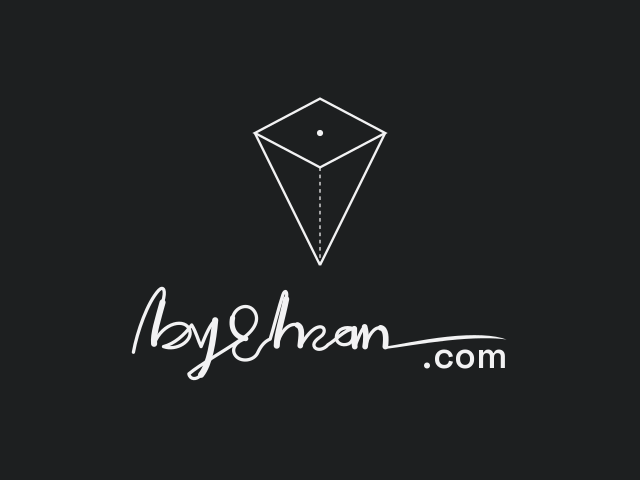

# K36 (ArkOS) boot branding

byEhsan branding for the K36, an R36S-style RK3326 handheld, on its ArkOS card. It covers the boot screens, an animated boot intro, the EmulationStation loading splash, and the "Powered" badge in the menu.

<p align="center"></p>

## Boot (FAT boot partition)

| File | Goes to | What |
|---|---|---|
| `logo.mp4` | `/boot/logo.mp4` | 6 s intro, 640×480. The mark draws on, the signature writes itself, ".com" types on, then it fades to black. ArkOS plays it with ffplay before EmulationStation. |
| `logo.bmp` | `/boot/logo.bmp`, and `/boot/BMPs/byehsan.bmp` as a spare | 640×480, 24-bit: the settled lockup |
| `logo_kernel.bmp` | `/boot/logo_kernel.bmp` | 720×720, 24-bit: the same lockup |
| `preview.png` | — | the settled frame, for this README |

All four come from `script/k36_intro.py`. Keep a copy of the stock `logo.bmp` (the card has it as `BMPs/arkos-stock.bmp`).

## EmulationStation (`arkos/`, root filesystem)

| File | Goes to | What |
|---|---|---|
| `splash.svg` | `/home/ark/.emulationstation/resources/splash.svg`, owned by `ark` (1002:1002) | Loading splash: the dark Powered badge. ES looks in `~/.emulationstation/resources/` before its built-in resources and draws `:/splash.svg` at 0.4 × the screen width. |
| `byehsan-powered.svg` | `/opt/byehsan/` | The same badge for the system view's top-right corner |
| `theme-block.xml` | `/opt/byehsan/` | The `<view name="system">` image block that places it |
| `powered.sh` | `/opt/byehsan/`, mode 0755 | Copies the badge into `es-theme-nes-box` and adds the theme block if it's missing, keeping `theme.xml.orig` |
| `byehsan-powered.service` | `/etc/systemd/system/`, enabled for `multi-user.target` | Runs `powered.sh` before EmulationStation on every boot, so a theme update just gets the badge added back |

The SVGs are the dark variant of the "Powered" badge (`poweredByBadgeHTML('dark')` in `index.html`), with text converted to outlines. EmulationStation renders SVGs with nanosvg, which has no `<text>` and no `rgba()`. So the muted "Powered" is flattened to `#929293`, and every color is a literal hex.

## Regenerating

```sh
pip install -r script/requirement.txt
python3 script/k36_intro.py          # writes logo.mp4, logo.bmp, logo_kernel.bmp, preview.png here
```

With the current `base.svg` and `signature.svg`, the BMPs come out pixel-identical to the ones on the card. The MP4's bytes vary with the ffmpeg build.
